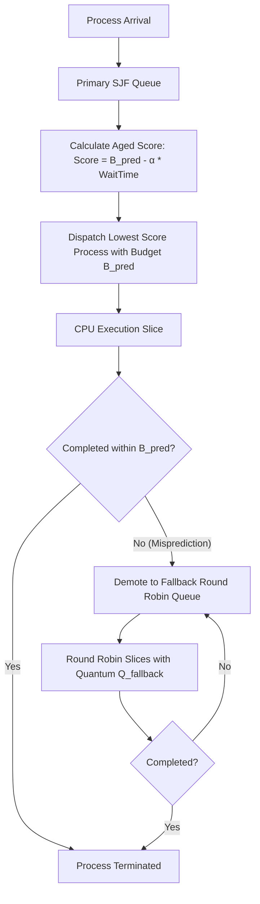

# Intelligent CPU Scheduling Using Machine Learning and Traditional Scheduling Algorithms

An advanced Operating Systems simulation platform comparing traditional CPU scheduling algorithms with machine-learning-augmented hybrid scheduling. The system models realistic OS scheduling dynamics—including preemption, speculative execution, dynamic aging, misprediction recovery, context switching, and multi-class workloads—without requiring kernel-level modifications.

---

## 1. System Architecture

The project is structured into clean, decoupled modules:

```
osProject/
├── cpp/                           # High-Performance C++17 Scheduling Core
│   ├── include/
│   │   ├── process.hpp            # Process structure, Gantt segment & metric schemas
│   │   ├── scheduler.hpp          # Base scheduler with turnaround, wait, & fairness metrics
│   │   ├── fcfs.hpp / fcfs.cpp    # First-Come First-Served implementation
│   │   ├── sjf.hpp / sjf.cpp      # Non-preemptive Oracle & Estimated SJF
│   │   ├── round_robin.hpp/.cpp   # Preemptive Round Robin with context switch overhead
│   │   ├── adaptive_rr.hpp/.cpp   # Adaptive Round Robin with dynamic quantum
│   │   ├── ml_hybrid.hpp/.cpp     # Proposed ML-SJF Hybrid (Aging + Demotion)
│   │   ├── json_helper.hpp        # High-speed native JSON parser and serializer
│   │   └── simulator.hpp/.cpp     # Multi-algorithm orchestration engine
│   ├── tests/
│   │   └── test_schedulers.cpp    # C++ unit test suite (9 test suites)
│   └── Makefile                   # Clang++/G++ compilation targets
│
├── ml/                            # Machine Learning Subsystem
│   ├── dataset_generator.py       # Telemetry generator for 5 workload types
│   ├── feature_pipeline.py        # Strict anti-leakage extraction & chronological splitter
│   ├── train_model.py             # Model training, evaluation & inference latency profiling
│   ├── predict.py                 # Real-time inference service with feature imputation
│   └── models/                    # Serialized models (.joblib) & evaluation summaries
│
├── backend/                       # REST API & Subprocess Bridge
│   ├── app.py                     # Flask application entry point
│   ├── routes.py                  # Simulation, workload, model & telemetry endpoints
│   ├── cpp_bridge.py              # Subprocess bridge with JSON IPC to C++ engine
│   └── workload_generator.py      # Workload bridge & I/O simulation modeling docs
│
├── frontend/                      # Interactive Web Dashboard
│   ├── index.html                 # Semantic HTML5 layout with analytics panels
│   ├── css/style.css              # Dark/light theme responsive CSS3 design
│   └── js/
│       ├── app.js                 # Dashboard state, presets, and simulation dispatcher
│       ├── gantt.js               # Responsive Gantt chart visualizer
│       └── charts.js              # Chart.js metric & feature importance graphs
│
├── tests/                         # Comprehensive Automated Test Suites
│   ├── test_cpp_engine.py         # C++ binary bridge tests
│   ├── test_ml_model.py           # Anti-leakage, split integrity & prediction tests
│   ├── test_workloads.py          # Workload distribution & reproducibility tests
│   ├── test_api.py                # Flask REST API endpoint verification
│   └── test_scenarios.py          # Starvation, aging, misprediction & fairness tests
│
├── requirements.txt               # Python package dependencies
└── README.md                      # Complete system documentation
```

---

## 2. Scheduling Configurations Compared

The simulator evaluates six scheduling configurations side-by-side on identical process arrival streams:

| # | Configuration | Type | Characteristics & Theoretical Properties |
|---|---|---|---|
| **1** | **FCFS** | Non-preemptive | Simple FIFO queue. Suffers severely from the **convoy effect** when compute-intensive processes block short interactive tasks. |
| **2** | **Round Robin (RR)** | Preemptive | Fixed time-slice ($Q$) rotation. Offers strong response times and fairness, but suffers from high context-switch overhead if $Q$ is too small. |
| **3** | **Oracle SJF** | Non-preemptive | Optimal theoretical lower bound for average waiting time ($AWT$). Uses exact, true future burst times (unobtainable in real kernels). |
| **4** | **Estimated SJF** | Non-preemptive | Textbook approach using exponential smoothing of past burst history ($\tau_{n+1} = \alpha t_n + (1-\alpha)\tau_n$). Susceptible to starvation for long jobs. |
| **5** | **Adaptive Round Robin (ARR)** | Preemptive | Dynamically calculates time quantum per scheduling cycle based on the median of remaining burst times of ready processes: $Q_{dyn} = \text{median}(\{r_i\})$. Expands slice during compute-heavy periods and tightens during interactive bursts. |
| **6** | **ML-SJF Hybrid (Proposed)** | Preemptive / Speculative | Schedules by ML-predicted burst duration $B_{pred}$. Incorporates dynamic aging to prevent starvation, and preemptively demotes jobs exceeding $B_{pred}$ to a fallback Round Robin queue. |

---

## 3. The Proposed ML-SJF Hybrid Algorithm

### Core Motivation:
Standard SJF provides minimal average waiting time but requires prior knowledge of burst times and risks indefinite postponement (starvation) of long jobs. Pure Round Robin prevents starvation but produces higher waiting times. The **ML-SJF Hybrid** unites predictive dispatch with dynamic aging and speculative fail-safes:



### Key Mathematical Formulations:
1. **Dynamic Aging Priority**:
   $$\text{EffectiveScore}(P_i, t) = B_{pred}(P_i) - \alpha \times \text{WaitingTime}(P_i, t)$$
   As a long process waits in the ready queue, its effective score steadily decreases. Once it has waited sufficiently, its score drops below newly arrived short jobs, guaranteeing CPU allocation and eliminating starvation.

2. **Speculative Execution Slice**:
   $$\text{Slice}(P_i) = \min\left(R(P_i),\, B_{pred}(P_i) - E(P_i)\right)$$
   where $R(P_i)$ is remaining actual burst and $E(P_i)$ is cumulative execution time.

3. **Misprediction Demotion**:
   If an ML model underestimates a job's true duration ($E(P_i) \ge B_{pred}(P_i)$ while $R(P_i) > 0$), the process is preempted and shifted to the **Fallback Round Robin Queue** ($Q_{fallback}$). This prevents rogue long jobs from monopolizing the CPU.

---

## 4. Machine Learning & Telemetry Pipeline

### Prevention of Data Leakage
To ensure realistic operating system telemetry, the model **never** uses future CPU burst time as an input feature. Only pre-scheduling metadata available at process creation or arrival time is utilized:

- `process_category`: Process execution class (0=Interactive, 1=Batch, 2=Computational, 3=System daemon).
- `memory_mb`: Requested resident memory footprint.
- `priority_level`: Process Unix nice level (mapped 0–10).
- `thread_count`: Spawned worker thread count.
- `past_burst_avg`: Historical average of past CPU bursts for this program executable.
- `past_io_rate`: Historical frequency of I/O wait operations.
- `arrival_interval`: Inter-arrival duration since previous process admission.
- `queue_length_at_arrival`: Instantaneous ready queue depth at arrival time.

### Train/Test Split
Data is generated in chronological order and split **temporally** (first 80% for training, final 20% for testing) to prevent temporal data leakage.

### Measured Empirical ML Results
| Model | MAE (ms) | RMSE (ms) | MAPE (%) | $R^2$ Score | Single-Process Inference Overhead |
|---|---|---|---|---|---|
| **Decision Tree Regressor** | **3.77 ms** | **6.76 ms** | **18.56%** | **0.7975** | **~330 µs** |
| **Random Forest Regressor** | **3.29 ms** | **5.46 ms** | **16.24%** | **0.8677** | **~13.6 ms** |
| **Gradient Boosting Regressor**| **3.37 ms** | **5.87 ms** | **16.56%** | **0.8470** | **~427 µs** |

> **Empirical Insight (No Assumed ML Superiority):**
> While Random Forest achieves a marginally lower MAE, its inference latency (~13.6 ms) is 40× slower than a Decision Tree (~330 µs). In an operating system where scheduling decisions occur at sub-millisecond granularity, a single Decision Tree or Gradient Boosting regressor provides the superior latency/accuracy trade-off. Furthermore, when prediction variance is high, Round Robin or Adaptive RR may be more computationally optimal than ML.

---

## 5. Workload Models & I/O Simulation

The simulator includes five distinct synthetic workload profiles:
1. **CPU-Bound**: Sustained compute bursts (mean 28ms, up to 60ms), large memory footprints, multithreaded jobs.
2. **I/O-Bound**: Rapid CPU bursts (mean 1–5ms) followed by immediate yielding, low memory, single-threaded loops.
3. **Mixed**: Realistic general-purpose workload (35% interactive, 30% batch, 25% compute, 10% system).
4. **Heavy-Tailed (Pareto)**: Power-law distribution ($x_m = 2.0, \alpha = 1.4$). 80% of jobs are short (1–6ms), while 20% are massive outliers (up to 120ms).
5. **Bursty**: Non-stationary Poisson arrival spikes with acute ready queue contention (inter-arrival $< 0.5$s).

### I/O Blocking Simulation Model
- **Discrete Burst Activation Model**: In this simulator, each process entry represents an active CPU burst between I/O wait intervals.
- I/O-bound tasks model rapid yields and short bursts before blocking.
- When full multi-phase CPU-I/O-CPU sequences are modeled, the return from I/O wait is represented as an arrival event with its elapsed arrival time, accurately testing queue re-admission and preemption without simulating a virtual disk controller.

---

## 6. Installation & Setup

### Prerequisites
- macOS (Apple Silicon or Intel) or Linux
- Clang++ or G++ supporting C++17
- Python 3.10+ and pip

### Step 1: Clone and Navigate
```bash
cd /Users/aarushigupta/Desktop/osProject
```

### Step 2: Install Python Dependencies
```bash
python3 -m pip install -r requirements.txt
```

### Step 3: Compile C++ Engine
```bash
cd cpp
make clean && make
cd ..
```
This builds `./cpp/scheduler_engine` (CLI simulation binary) and `./cpp/test_runner` (C++ unit tests).

### Step 4: Train Machine Learning Models
```bash
python3 ml/train_model.py
```
This generates synthetic workload telemetry, performs chronological validation, evaluates Decision Tree, Random Forest, and Gradient Boosting regressors, profiles inference latency, and saves the models to `ml/models/`.

### Step 5: Launch the Web Dashboard
```bash
python3 backend/app.py
```
Open your browser and navigate to:
```
http://127.0.0.1:5001
```

---

## 7. Running Tests

### Run C++ Native Unit Tests (9 Tests)
```bash
cd cpp && ./test_runner && cd ..
```
Verifies:
- FCFS textbook manual calculations
- Simultaneous arrivals at $t=0$
- Idle CPU periods and gap tracking
- Context-switch overhead penalties
- Oracle SJF vs Estimated SJF discrimination
- ML-SJF underestimation detection & RR demotion
- Starvation prevention via dynamic aging
- Adaptive Round Robin quantum adjustment
- Jain's Fairness Index correctness

### Run Python Automated Test Suite (24 Tests)
```bash
python3 -m pytest tests/ -v
```
Verifies:
- Data leakage prevention in feature pipelines
- Chronological split integrity
- Synthetic workload distribution characteristics and reproducibility
- Live REST API endpoints (`/api/health`, `/api/workload`, `/api/predict`, `/api/simulate`)
- Starvation stress tests and misprediction recovery

---

## 8. Performance Metrics Formulations

1. **Average Waiting Time (AWT)**:
   $$AWT = \frac{1}{N}\sum_{i=1}^N (TAT_i - BT_i)$$
2. **Average Turnaround Time (ATT)**:
   $$ATT = \frac{1}{N}\sum_{i=1}^N (CT_i - AT_i)$$
3. **Average Response Time (ART)**:
   $$ART = \frac{1}{N}\sum_{i=1}^N (ST_i - AT_i)$$
4. **Throughput**:
   $$\text{Throughput} = \frac{N}{T_{makespan}}$$
5. **CPU Utilization**:
   $$\text{Utilization} = \frac{\sum \text{BusyTime}}{T_{makespan}} \times 100\%$$
6. **Jain's Fairness Index ($J$)**:
   Evaluated over normalized turnaround efficiency $r_i = \frac{BT_i}{TAT_i}$:
   $$J = \frac{\left(\sum_{i=1}^N r_i\right)^2}{N \sum_{i=1}^N r_i^2}, \quad 0 < J \le 1.0$$
